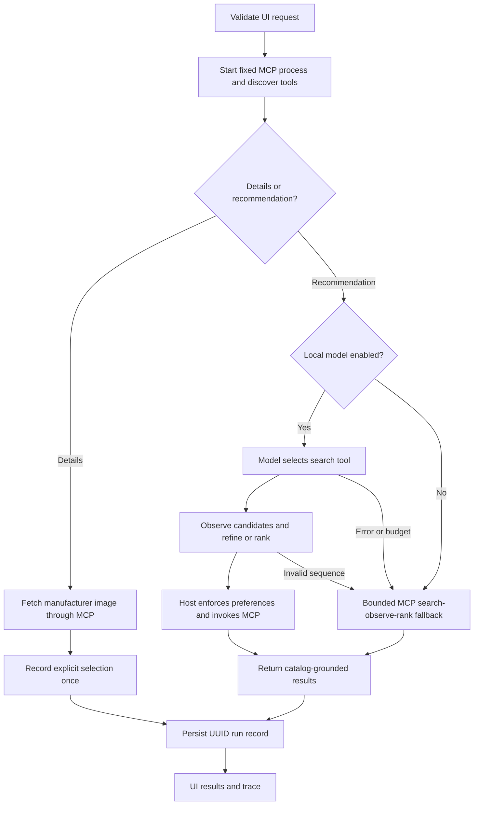

# Framework for agentic work

## Architecture

The framework is a custom bounded Python asyncio orchestrator (`agent.py`) with a local Ollama tool loop (`model_agent.py`). FastAPI/Uvicorn serves the browser UI. The official MCP Python SDK provides ClientSession, stdio_client, and mcp.server.fastmcp.FastMCP. SQLite provides persistence. MCP is the tool protocol; Ollama/Mistral provides model decisions. No external agent framework is implied.

Every request creates a fresh process/session, initializes MCP, discovers tools, and checks required capabilities. Disc search, ranking, image fetching, and selection tracking cross the MCP boundary in both model and fallback modes. The catalog endpoint only bootstraps the UI.

Post-search directional refinement uses a `bounded-shift` branch: validated reference ID and direction → `shift_discs` MCP tool → observe candidates → `rank_discs` MCP tool. Explicit buttons require no model interpretation. The tool compares speed or turn + fade strictly against the leading result and scores proximity to a one-point directional target. Preferences and bag exclusions remain host-owned. Reference/direction are recorded in the run log. Speed limits are enforced in both UI and tool.

## Planning and authority

The default local model is `mistral:7b`; `DISC_AGENT_MODEL` selects another installed tool-capable model. The loop permits four chat turns, at most two calls processed per turn, and a 25-second planning deadline. Search observations are fed back to the model, which can refine a search and select ranking. Missing calls get a reminder within the same finite budget.

The recommendation model sees only search/rank tools. The host overrides model-proposed brand filters, bag exclusions, sort order, and candidate lists with validated preferences and actual search observations. The model-facing rank schema omits candidate payloads; the host injects them into the full MCP call. This avoids copying large data through model output and prevents fabricated final results. Model query normalization can still misunderstand intent; result reasons identify the interpreted reference comparison.

Failure invokes deterministic search of the original query, observation of empty/nonempty candidates, and ranking only when useful. Brand preferences are never silently relaxed. The modes `local-model`, `bounded-workflow`, and `bounded-fallback` identify actual execution; the fallback is not described as an LLM agent.

## Budgets, failures, and audit

The workflow has a 65-second deadline and individual tools 40 seconds. Read tools retry once; non-idempotent selection increments never retry. Manufacturer fetching has eight-second network timeouts, four-hop redirects, and two MB page bounds. Successful image URLs are cached for a day; expired entries are explicitly returned as stale if fetching fails. Images are fetched on demand after selection, leaving ranking independent of manufacturer availability.

The workflow boundary catches model, startup, transport, and tool failures. Model fallback traces record error classes without dumping model internals. Selection-storage failure does not discard an image. Log-write failure adds a warning. The browser preserves existing results and saved bag and handles its own request/image failures.

Every run has a UUID shown in the UI and stored as a separate UTF-8 JSON file under runtime/, avoiding shared-log write collisions. Records include timestamp, original query, preferences, results, references, mode, tool statuses, attempts, and elapsed time. SQLite stores selection counts and image cache. These local operational records are not immutable compliance logs. Build decisions and checks are recorded separately in WORK_LOG.md.

This is a local, single-user architecture with inspectable tools and optional model planning. It has no distributed queue, scheduled crawl, remote tool registration, or multi-user identity. External MCP hosts may launch the server over stdio.
